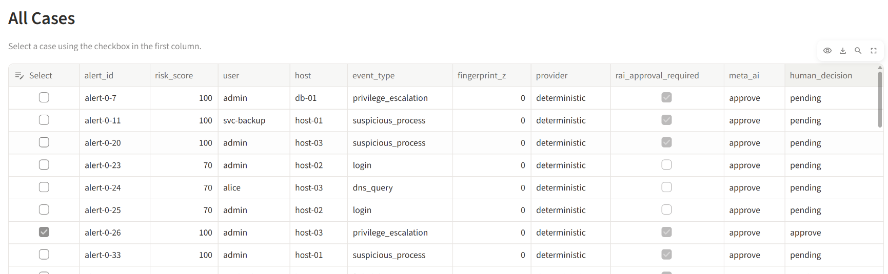
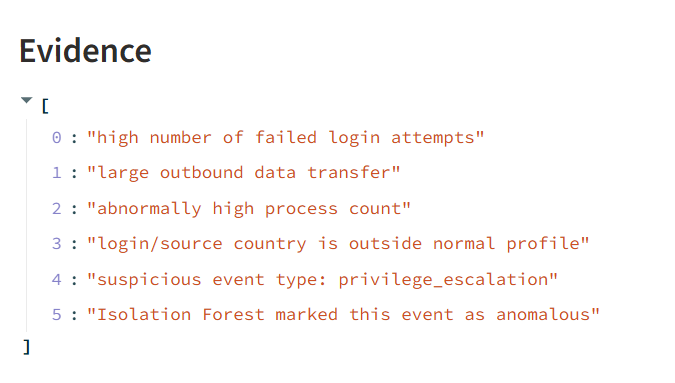
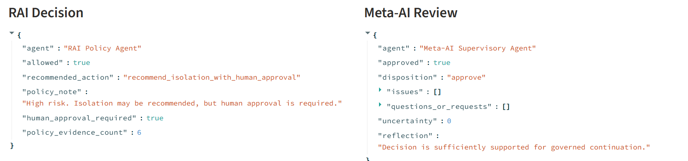

# Lab 2a – Human-guided AI analysis in an agentic SOC

**Student:** Adi Tavakoli , Tamara Karanovich
**Date:** 8 November 2026  
**Mode:** Normal teaching mode (`LAB2A_RESEARCH_MODE=0`), deterministic CPU inference

---

## 1. Setup

All services were started in order: Redpanda + Console (Docker) → detector → orchestrator → telemetry generator → Streamlit dashboard. The detector and orchestrator were started before the generator because they only read new Kafka messages, so starting them later would miss the first events.

| Service | Role in the architecture | Address |
|---|---|---|
| `telemetry_generator.py` | Data / telemetry (producer) | – |
| Redpanda (Kafka) | Event bus | `localhost:19092` |
| `morpheus_lite_detector.py` | Detection agent service | – |
| `agent_orchestrator.py` | Investigation + governance agents | – |
| Streamlit dashboard | Human decision interface | http://localhost:8501 |
| Redpanda Console | Inspect topics | http://localhost:18080 |

### Problems I solved during setup
- **Python 3.15 was too new.** PyYAML had no prebuilt package for it and needed a C++ compiler. I recreated the virtual environment with **Python 3.12**.
- **kafka-python 3.x** was installed automatically (the requirement is only `>=2.0.2`) and could not connect to the broker. I installed `kafka-python<3` (2.3.3).
- **Port conflict:** `netstat` showed that `wslrelay.exe` (WSL localhost forwarding) was also listening on `127.0.0.1:18080` and `127.0.0.1:19092`, next to Docker. Connections went to WSL instead of Docker and were reset. I set `localhostForwarding=false` in `.wslconfig`, ran `wsl --shutdown`, and restarted the containers. After that only Docker listened on the ports and the detector connected.

---

## 2. Selected case

| Case field | Observation |
|---|---|
| alert_id | `alert-0-26` |
| correlation_id | `539b5d4b-8c84-4bdf-a11c-677767be5ba4` |
| risk score / event type | 100 / `privilege_escalation` |
| user / host | `admin` / `host-03` |
| AI recommendation | `recommend_isolation_with_human_approval` |
| human approval required | Yes |
| Meta-AI disposition | `approve`, uncertainty 0, no issues |

I chose this case because it has the highest risk score and requires human approval, so the final decision really depends on the analyst.

---

## 3. Evidence analysis

**Observed facts (from the log record):**
The `admin` account on `host-03` produced a `privilege_escalation` event. The same record shows a high number of failed logins, a large outbound data transfer, an abnormally high number of processes, and a source country outside the normal profile.

**Model output:**
The Isolation Forest model marked the event as anomalous. This is a calculation, not a new observation, because the model uses the same five values (failed logins, bytes out, process count, country, event type) as the other evidence items.

**AI interpretation and recommendation:**
The system gave a risk score of 100 and interpreted the event as a likely attack. The RAI policy recommends isolating the host, but only with human approval.

**Strengths of the evidence:**
- Five different warning signs appear together, and together they tell a typical attack story: password guessing → access → privilege escalation → many processes → data sent out (possible exfiltration).
- The affected account is `admin`, a high-value account, so the possible damage is large.
- The governance layer worked correctly: the AI did not act by itself and asked a human to decide.

**Uncertainties and missing evidence:**
1. **Single source.** All the evidence comes from one log record. There is no independent confirmation from endpoint (EDR), firewall/network or identity-provider logs. If this record were wrong or spoofed, every evidence item would be wrong together.
2. **Double counting.** The Isolation Forest item reuses the same features as the other items, so there are really 5 evidence items from 1 source, not 6 independent ones.
3. **No exact values.** The explanation does not show how many failed logins, how much data was sent, to which destination, or from which country. Without numbers it is hard to judge how serious the event is.
4. **No user baseline.** `fingerprint_z = 0` means there was no comparison with the admin's normal behaviour. The admin might normally run large backups or work through a foreign VPN.
5. **Overconfident Meta-AI.** The Meta-AI reported uncertainty 0 and no issues. In this lab the confidence is simply the risk score divided by 100, and the Meta-AI only checks simple rules (for example, at least two evidence items). It did not notice that all the evidence comes from one source.
6. **Limited XAI.** In deterministic mode the explanation is a template that lists the evidence. It does not reason about why the evidence means an attack or consider other explanations.

**False positives I noticed:**
`alert-0-23`, `alert-0-24` and `alert-0-25` had risk score 70 for normal events (`login` and `dns_query`). These alerts came only from the Isolation Forest flag, with no rule-based evidence. This shows the detector can produce false positives, so its output should not be trusted automatically.

---

## 4. Human decision

**Decision:** `approve` (isolate `host-03`)

**Justification (as recorded in the dashboard):**
> I approve isolating host-03. The admin account shows privilege escalation together with many failed logins, a large outbound data transfer and a source country outside the normal profile, which looks like a compromised account sending data out. Isolation is proportionate because it affects only one host and can be reversed, while data theft cannot. The RAI policy requires human approval for this high-risk action, so the final responsibility is mine. However, all clues come from a single log record without endpoint or network confirmation, the user fingerprint has no baseline (z=0), and the Meta-AI's uncertainty of 0 seems overconfident. After isolation, EDR and firewall logs should be checked, and the host restored if the activity is legitimate.

---

## 5. Reflection questions

1. **Which evidence most influenced your decision?**  
   The combination of **privilege escalation by the admin account** and the **large outbound data transfer** influenced me most. Together they suggest that an attacker has already gained high privileges and may be stealing data right now. That is ongoing harm that cannot be undone, so waiting is risky. The failed logins and the foreign country supported this story but would not be enough alone.

2. **Did your decision agree with the AI recommendation? Explain why.**  
   Yes, I agreed with isolating the host, but not automatically. I checked the evidence myself and found weaknesses the AI did not mention: one single source, the double-counted Isolation Forest item, no user baseline, and an overconfident Meta-AI. I still approved because the action is limited to one host and reversible, while the possible damage is not. I added a condition: verify with endpoint and network logs after isolation and restore the host if it was a false alarm.

3. **What did the XAI explanation clarify, and what remained uncertain?**  
   It clarified **which** signals caused the alert and what action was recommended. It did not give the actual values (number of failed logins, amount of data, destination, country), it did not consider other explanations such as a VPN or a backup job, and it did not explain how confident it was in each signal. It listed the evidence but did not really explain the reasoning.

4. **How did the RAI approval requirement affect your decision?**  
   Because the risk was 85 or higher, the policy did not allow the AI to isolate the host by itself. This made me responsible for the decision, so I had to think about proportionality and consequences instead of simply trusting the score. It also made me write a justification, which is saved in the audit log so the decision can be reviewed later.

5. **What additional evidence would change your conclusion?**  
   - Evidence that would make me **reject** or reverse the isolation: confirmation that the admin was travelling or using a company VPN, proof that the large transfer was a scheduled backup, or a clean EDR scan of host-03.  
   - Evidence that would make me **more confident**: firewall logs showing data sent to a known malicious IP, EDR alerts showing malware or new admin tools on host-03, or identity logs showing a successful login right after the failed attempts.

6. **Who retained final authority over the proposed response?**  
   I did, as the human analyst. The AI agents only detected, explained and recommended. My decision and justification were sent to the `human.decisions` topic and saved in the audit log, so it is clear who decided, what was decided and why.

---

## 6. Lecture-to-lab reflection

- **Which part of the workflow is an agent, and which is a model or a pipeline?**  
  The **model** is the Isolation Forest: it only turns input numbers into an anomaly prediction. The **pipeline** is the fixed flow generator → Kafka → detector → orchestrator → dashboard. The **agents** are the Threat Hunter, RAI Policy, XAI and Meta-AI components, which interpret the alert, apply policy and review each other. The detector also keeps state (user fingerprints). In this lab the agents are simple rule-based programs, so they show the architecture of an agentic SOC rather than fully autonomous agents.

- **What evidence would justify an automated intervention? What is still missing?**  
  Automatic isolation would need several strong signals confirmed by **independent sources**: for example, the log record plus an EDR alert on the host plus firewall traffic to a known malicious address, together with a user baseline that shows clearly abnormal behaviour. In this case the independent confirmation and the baseline were missing, so human approval was needed.

- **What can a human decision-maker challenge that a deterministic pipeline cannot?**  
  A human can question context and assumptions: Is the admin travelling? Is this a backup job? Do the evidence items really come from different sources? I noticed the double counting and the zero uncertainty, which the pipeline accepted without question. A human can also weigh business impact and proportionality, for example the difference between isolating a workstation and isolating a database server.

- **Which interactions were directly observed versus self-reported? Why does this matter for research?**  
  **Directly observed** interactions are recorded by the system, for example selecting a case or submitting a decision. **Self-reported** interactions are the Research Mode buttons such as "I inspected evidence". Clicking them does not prove careful inspection. For research this matters because self-reported data can be inaccurate, so conclusions about how people use AI should rely more on observed behaviour or be clearly labelled as self-reported.
